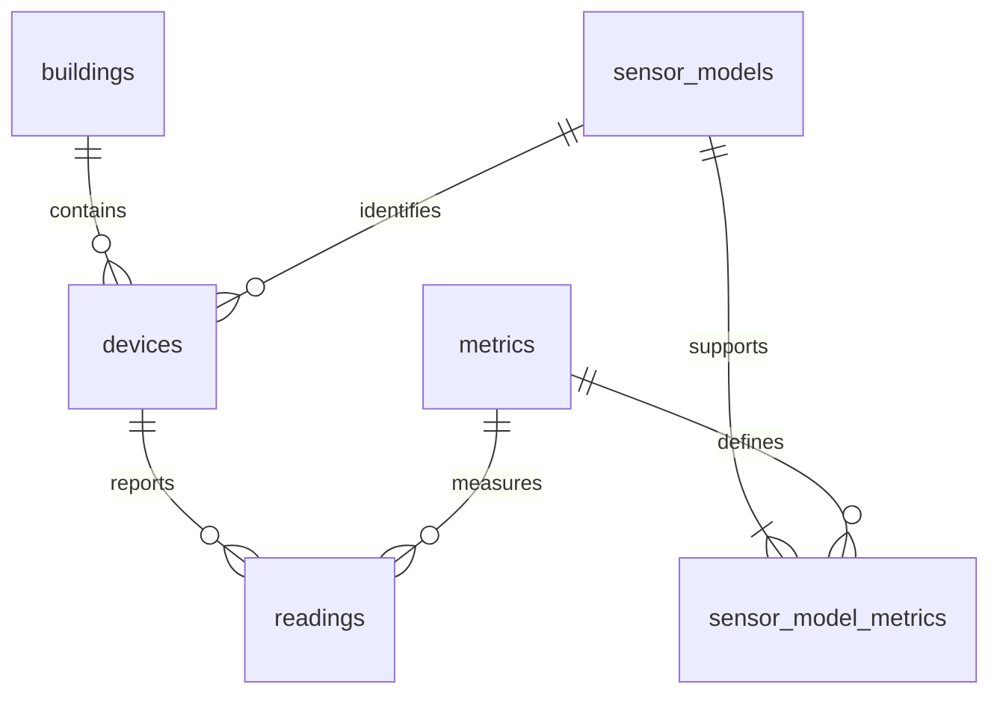

# Database design and operation

The application has one PostgreSQL 16 / TimescaleDB 2.17.2 database. The complete
definition is [`0001_baseline.sql`](../app/db/migrations/0001_baseline.sql).
This replaces the six pre-baseline migrations; it is deliberately a fresh-start
release, not an in-place conversion of their historical data.

ChirpStack's PostgreSQL database and Redis are separate, vendor-managed network
server state. Do not merge their tables into the application's schema or reset
them to rebuild sensor telemetry.

## Install or replace the old application database

On the Linux server, use the project launcher:

```bash
# Existing pre-baseline installation: discards application data/registry edits.
bash run.sh --reset-database

# Subsequent starts: validates the baseline and preserves data and edits.
bash run.sh
```

For a brand-new installation without `.env`, use `bash run.sh --local` or
`bash run.sh --domain YOUR_HOSTNAME`. Keep an existing `.env`; the launcher adds
missing runtime passwords without replacing existing credentials.

`--reset-database` stops API, ingestion and Grafana, then rebuilds only the known
application objects. It removes raw readings, hourly summaries, migration
history and registry edits, and re-seeds the supplied 12 AM103 devices. It does
not remove Docker volumes, ChirpStack registrations/keys, MQTT data, or Grafana
configuration. Unknown dependent objects cause rollback, rather than being
removed with `CASCADE`. Ordinary startup refuses an old or unknown migration
ledger and gives the explicit reset command.

DDL, seed data, migration records and role grants commit in one transaction.
An advisory lock serializes installers. Checksums ignore Windows/Linux newline
differences; an edited applied baseline is rejected. Once this new baseline is
deployed, future schema changes still require versioned migrations. Rewriting
an installed migration silently is never a deployment strategy.
Transactions that collide with Timescale background jobs retry up to three
times after rollback. SQL/constraint errors are reported without retrying.

## Relational model



| Object | Key and purpose |
| --- | --- |
| `buildings` | Identity PK; unique name and slug; archive with `is_active` |
| `sensor_models` | Model code PK; name and planned quantity |
| `metrics` | Canonical metric PK; name, unit, physical range and gauge/counter kind |
| `sensor_model_metrics` | `(model_type, metric)` PK; normalized capabilities and display order |
| `devices` | Identity PK; unique lowercase DevEUI; model/building FKs, label, current room and retirement flag |
| `readings` | `(device_id, metric, time)` PK; canonical value and separate database receipt time |
| `readings_hourly` | Derived hourly sample count, sum, average, minimum and maximum |
| `schema_migrations` | Applied filename PK, checksum and installation timestamp; owner access only |

Generated identity IDs are internal references; DevEUI identifies physical
hardware. Model and DevEUI cannot be changed on an existing device. A replacement
device gets another row. Use `is_active = FALSE` to retire hardware: deleting
devices is prohibited even after their raw data expires, so indefinite hourly
history keeps its identity. Buildings/models/metrics use restrictive foreign
keys. Blank labels, malformed DevEUIs, unknown models, unsupported metrics,
non-finite values and readings outside their canonical physical range are
rejected by the database. All baseline constraints are validated from day one.

Capabilities are rows, not an array stored in `sensor_models`. The inventory API
assembles its existing `metrics` list from those rows, preserving the client
contract. AM103 has 12 planned devices; AM107 and CT305 have zero planned units
but retain their decoders and metric definitions. Library is inactive; KEH,
EOJ, ARK and SiS are active. No synthetic readings or LoRaWAN AppKeys are seeded.

Room/building identify a device's **current placement**. Historical queries
group by that current placement, not by a historical room assignment. If a
device is moved, its displayed history moves with it. A temporal installation
registry would be a separate feature if historical location attribution is
required. Labels and rooms can be edited without changing measurement identity.

## Measurements, time and concurrency

`time` is a timezone-aware measurement timestamp normalized to UTC. Ordinary
periodic fields prefer the earliest ChirpStack `rxInfo.nsTime` network-server
receipt timestamp. The integration event's top-level `time` can be derived from
gateway/GPS metadata, so blindly using it can backdate live reports when an
upstream clock is wrong. Legacy events without NS metadata retain their explicit
top-level timestamp and log a warning if it is over 45 minutes behind ingestion.
Neither path substitutes local receipt "now", so queued/repeated messages keep
their original age and identity. Network receipt time is not a claim that the
sensor sampled at that precise instant. AM103 `20ce` timestamped records use
their embedded sensor sample time. A retransmitted sample keeps its old age
even when its network event arrives now. Multiple records in one uplink keep
their separate sample times, and normal fields after a history block are still
decoded. Samples outside the admission window are skipped individually.
Messages without a network timestamp are rejected: generating a receipt
timestamp would make retransmissions appear to be new measurements.
`received_at` is separate and records when the database first accepted a row.

One device can have one value per metric and measurement timestamp. Both live writes
and buffered replay use `INSERT ... ON CONFLICT (device_id, metric, time) DO
NOTHING`; the first committed value wins and its receipt time stays unchanged.
The primary key enforces this across all writers. No advisory device locks or
check-then-insert race is needed. The ingest account cannot update/delete data.

The database rejects timestamps older than 88 days or more than five minutes in
the future. The API excludes future timestamps when showing current/history
values. Supported metric/range validation uses a trigger with a fixed search
path; it locks catalog/device rows while validating to serialize concurrent
retirement/catalog changes. Clock-dependent admission rules use a trigger,
not a time-dependent `CHECK` constraint.

The in-memory retry buffer is bounded and is not durable across process loss.
Only transient database failures are retried. Permanently invalid uplinks are
discarded with a log; an invalid/retired device cannot block other buffered
uplinks. MQTT remains QoS 0, so uniqueness does not imply guaranteed delivery.

Freshness uses the oldest required climate metric for each air sensor, rather
than its battery/report receipt time. The summary identifies the responsible
`device_id`, `device_label`, `metric`, `latest_reading`, `received_at` and `checked_at` in
`data_quality.freshness`. Its description includes the exact measurement time.
When a selected stale row was just stored, the description also includes its
first storage timestamp. The current-reading response exposes per-metric
`metric_received_at` alongside `metric_updated`. A recent storage time never
silently makes a genuinely old measurement current. Ingest logs upstream clock
mismatches, subscription acknowledgement, unsupported payloads, timestamp
rejection, and the SQLSTATE/reason for rejected writes.

Canonical units are fixed for a metric key (for example `co2` in ppm,
`temperature` in degC, phase current in A, cumulative phase current in Ah).
Changing a unit's meaning requires a new metric/conversion, not editing the
unit on historical data. Physical ranges are admission checks, not health or
comfort thresholds. CT305 totals are counters: averages are not energy usage
or consumption; any derived consumption must handle resets and counter deltas.

## Indexes, aggregates and retention

The hypertable has seven-day chunks. Its composite PK includes the time
partition key and supports device/metric/latest lookups. Additional indexes
serve device/time, metric/time, and time-only range queries; foreign-key lookup
columns in ordinary tables are indexed as well.

Raw retention is 90 days and operates on complete chunks, so it can retain a
little more than 90 days. Hourly summaries are indefinite. Each hourly refresh
covers the previous 89 days up to one hour ago: accepted late arrivals get
materialized, and raw retention stays outside the refresh boundary. The newest
hour is available through raw data; summary materialization is asynchronous.
Admission stops at 88 days to leave a day for full-hour bucket alignment and
scheduled processing before a late sample leaves the refresh window.

For a combined average, use `sum(sum) / sum(sample_count)` rather than averaging
hourly averages. Raw deletion must use the retention policy, not arbitrary
historical row deletion followed by a refresh. Backfill outside the admission
window requires an explicit maintenance procedure and aggregate refresh.

## Permissions and DBeaver

| Account | Permission | Secret in `.env` |
| --- | --- | --- |
| `POSTGRES_USER` | Schema/role administration by the migration job | `POSTGRES_PASSWORD` |
| `sensorhub_api` | SELECT on application data; read-only transactions | `API_DB_PASSWORD` |
| `sensorhub_ingest` | Read registration/catalog and measurement keys; INSERT measurement columns | `INGEST_DB_PASSWORD` |
| `grafana_reader` | SELECT on application data; read-only transactions | `GRAFANA_DB_PASSWORD` |

Runtime accounts do not receive migration-ledger access, CREATE, UPDATE, DELETE
or default grants to future tables. The reading validation trigger executes
with its owner's rights solely to validate/lock catalog rows. These accounts
are for one application deployment per PostgreSQL instance.

DBeaver can use the PostgreSQL driver at `127.0.0.1`, port `POSTGRES_PORT`
(default 5432), database `POSTGRES_DB`, user `grafana_reader`, and password
`GRAFANA_DB_PASSWORD`. For another computer, SSH-forward this loopback port.
Use the owner only when deliberately administering the schema/registries.

## Validation

```bash
python -m pytest -q
python tests/run_integration.py
```

The integration runner uses synthetic credentials, a unique Compose project,
random loopback ports and disposable volumes. Database contract checks create
their own uniquely named test database and verify baseline installation,
restart idempotency, concurrent deduplication, constraints, account permissions,
late-data aggregates, checksum handling, explicit reset and rollback. The MQTT
and API checks then verify actual payload decoding and dashboard behavior,
including a broker restart. No user database/volume is selected for cleanup.

Design references: [PostgreSQL constraints](https://www.postgresql.org/docs/16/ddl-constraints.html),
[TimescaleDB unique keys](https://www.tigerdata.com/docs/build/performance-optimization/hypertables-and-unique-indexes),
[aggregate refresh and retention](https://www.tigerdata.com/docs/build/continuous-aggregates/refresh-policies).
